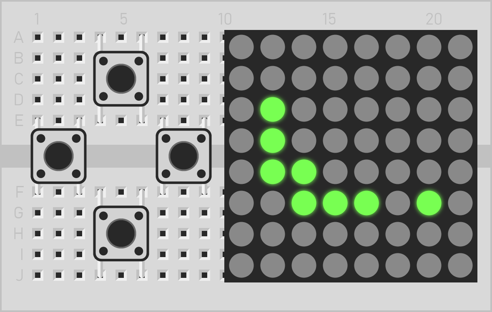
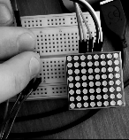

<h1 align="center">ESP32 Snake Game</h1>

<p align="center">
  The classic Snake game on an 8 × 8 LED matrix, powered by an ESP32.
  <br>
  A hands-on project for exploring C++, ESP-IDF and FreeRTOS.
</p>

<p align="center">
  <strong>ESP32</strong> · <strong>C++</strong> · <strong>FreeRTOS</strong> · <strong>SPI / MAX7219</strong>
</p>

<p align="center">
  
</p>

<p align="center">
  <a href="#demo">Demo</a> ·
  <a href="#features">Features</a> ·
  <a href="#how-it-works">How it works</a> ·
  <a href="#hardware">Hardware</a> ·
  <a href="#build-and-flash">Build &amp; flash</a>
</p>

## Demo

The game running on a MAX7219-driven LED matrix, controlled with four physical buttons.

<p align="center">
  
</p>

## Features

- **Classic Snake gameplay** — collect food to grow; colliding with the snake's body restarts the game.
- **Wraparound movement** — crossing an edge brings the snake back on the opposite side of the 8 × 8 field.
- **Four-button controls** — GPIO interrupts send direction events to a FreeRTOS queue; the game ignores direct reversals.
- **Animated startup and restart** — random pixels fill and clear the display before each round.
- **Dedicated display task** — a separate FreeRTOS task sends changed rows to the MAX7219 over SPI.
- **Callback-based game integration** — drawing, timing and delays are supplied to the game through function pointers.

## How it works

```text
Buttons → GPIO interrupts → FreeRTOS queue → Main task → Snake game
                                                            ↓
                                                     Drawing callbacks
                                                            ↓
                                                     LED row buffer
                                                            ↓
LED matrix ← MAX7219 ← SPI ← Display task (checks every 10 ms)
```

1. **Capture input.** Each button generates a falling-edge interrupt. Its handler places a direction into a queue without changing the game state.
2. **Advance the game.** The main task calls `Snake_Task()`, handles at most one queued direction per iteration, then sleeps for 10 ms. Movement is timed separately, with a default step period of 250 ms.
3. **Update the pixels.** The game adds or removes points through callbacks. The display driver changes its row buffer and marks the affected rows for transmission.
4. **Refresh the display.** A dedicated task checks the buffer every 10 ms and writes changed rows to the MAX7219. It also keeps the display updating while the main task runs the game's animations and delays.

The firmware is split into three small C++ classes: [`snake_game`](main/snake.hpp) owns the game rules, [`led_matrix`](main/led_matrix.hpp) handles display buffering and SPI communication, and [`button`](main/buttons.hpp) configures an input and manages its interrupt registration. [`main.cpp`](main/main.cpp) connects them and supplies the FreeRTOS adapters.

## Hardware

| Component | Implementation |
| :--- | :--- |
| Development board | NodeMCU-32 / ESP32 |
| Display | One 8 × 8 LED matrix with a MAX7219 driver |
| Controls | Four momentary push buttons |
| Display interface | SPI, mode 0, 1 MHz |
| Firmware | C++ with ESP-IDF and FreeRTOS |
| Build tools | ESP-IDF command-line tools and CMake |

### Connections

The table reflects the pin assignments in [`main.cpp`](main/main.cpp).

| ESP32 pin | Connection |
| :--- | :--- |
| GPIO14 | MAX7219 CLK |
| GPIO13 | MAX7219 DIN |
| GPIO15 | MAX7219 CS / LOAD |
| GPIO12 | Configured as SPI MISO; no connection needed to the MAX7219 |
| GPIO27 | Left button → GND |
| GPIO26 | Right button → GND |
| GPIO25 | Down button → GND |
| GPIO10 | Up button → GND; see the board note below |
| GND | Common ground for the board, display and buttons |

Buttons use internal pull-ups and trigger when pressed to ground. Power the display according to your module's specifications and check its logic-level requirements before connecting it to the ESP32.

### Configuration

Application settings are grouped in the `config` namespace at the top of [`main.cpp`](main/main.cpp).

| Setting | Default |
| :--- | :--- |
| `snake_step_period_ms` | 250 ms |
| `field_width`, `field_height` | 8 × 8 |
| `loop_period_ms` | 10 ms for both application loops |
| `spi_frequency_hz` | 1 MHz |
| `matrix_brightness` | `0x0F` |
| `button_queue_length` | 16 direction events |
| `matrix_task_stack_bytes` | 4096 bytes |
| `matrix_task_priority` | 10 |

The display driver is written for a single 8 × 8 matrix. Changing the game's field dimensions alone does not add support for a larger display.

## Build and flash

### Prerequisites

- An ESP32 board and a USB data cable.
- ESP-IDF installed with the ESP32 toolchain; see Espressif's [installation guide](https://docs.espressif.com/projects/esp-idf/en/stable/esp32/get-started/index.html).
- An ESP-IDF terminal with `idf.py` available and `IDF_PATH` set.

The repository does not pin an ESP-IDF release or include a saved `sdkconfig`. The original SDK version is undocumented, so compatibility with a particular release needs to be checked when building. The firmware uses the ESP-IDF drivers directly; no Arduino framework or third-party components are required.

### Build from a terminal

```sh
git clone https://github.com/nktsb/esp32-snake-game.git
cd esp32-snake-game

idf.py set-target esp32
idf.py build
```

The build generates the firmware, bootloader and partition table in `build/`. To adjust ESP-IDF options before building, run `idf.py menuconfig`.

### Flash and monitor

Connect the board and replace `PORT` with its serial device:

```sh
idf.py -p PORT flash monitor
```

Typical port names are `/dev/ttyUSB0` on Linux, `/dev/cu.usbserial-…` on macOS and `COM3` on Windows. Exit the serial monitor with **Ctrl + ]**. See the official [idf.py reference](https://docs.espressif.com/projects/esp-idf/en/stable/esp32/api-guides/tools/idf-py.html) for more options.

After boot, the display runs its fill-and-clear animation and starts a new round. Use the four buttons to steer toward food; the game restarts automatically after a body collision.

## Repository layout

```text
.
├── .github/assets/
│   ├── snake.png        # Project artwork
│   └── demo.gif         # Hardware demonstration
├── main/
│   ├── main.cpp        # Configuration, callbacks, task startup and game loop
│   ├── main.hpp        # Shared SDK and standard-library includes
│   ├── snake.cpp/.hpp  # Movement, food, collision handling and animations
│   ├── led_matrix.cpp/.hpp
│   │                   # MAX7219 driver and LED row buffer
│   ├── buttons.cpp/.hpp
│   │                   # GPIO setup and interrupt registration lifetime
│   └── CMakeLists.txt  # ESP-IDF component sources
└── CMakeLists.txt      # ESP-IDF project entry point
```

This began as a learning project in 2024: a small, playable way to try C++ on a microcontroller and connect GPIO interrupts, queues, tasks and an SPI peripheral. The implementation remains intentionally compact; button debouncing and synchronization of the shared display buffer are possible next improvements.
